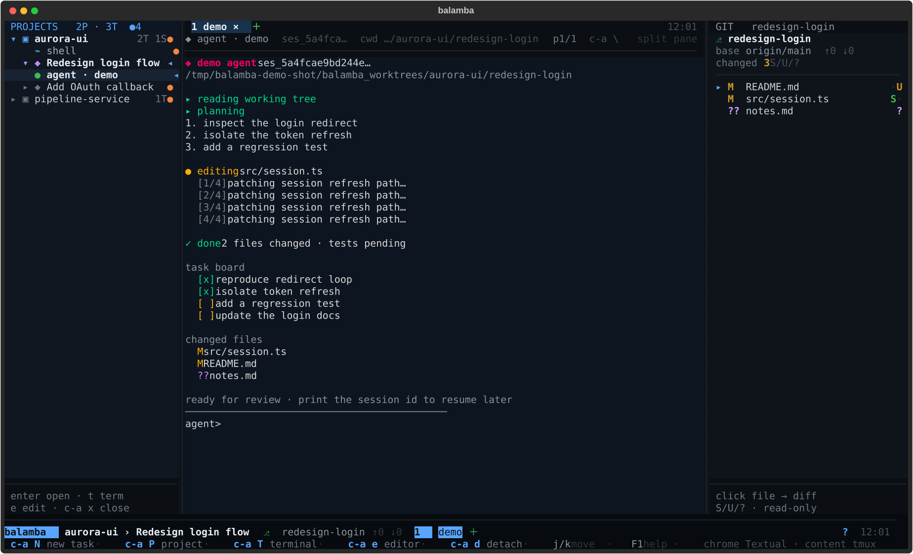

# balamba — a Textual reinterpretation of the tmux agent workspace

**Built 2026-11-25 10:44 CET · DeepSeek V4.1 Flash 1017 · v1.0.0**

Projects → git worktrees (tasks) → terminals, with full restore across restarts. The
challenge asks for tmux-driven chrome. **This build deliberately implements every piece of
chrome and interaction with Python + [Textual](https://textual.textualize.io/):** the
three-column layout, tree, git panel, tab strip, status bar, dialogs, context menus, key
bindings and mouse behaviour are Textual widgets, screens and events. A dedicated tmux
server (`-L balamba`) is used **only to host terminal processes**. No tmux status bar, no
tmux formats, no tmux mouse bindings, and no tmux key table are used for the interface.

It is still keyboard-first and still does the serious work: real worktrees, real branches,
real agent sessions, real terminal content, restore after a crash or reboot. The git surface
remains read-only-ish in the exact sense of the spec: worktree add/remove, branch creation,
`branch -d`, status, rev-list and diff. No commits, pushes or merges ever.

---

## Quick start

Prerequisites: Python ≥ 3.10, tmux ≥ 3.0, git, and Textual. `opencode` is only required if
you create `agent` tabs with the shipped default agent.

```bash
python3 -m pip install 'textual>=8.0'
cd balamba-tmux-agent-workspace
./bin/balamba                 # first launch: config files + workspace, then the TUI
```

Other entry points:

```bash
./bin/balamba doctor          # server/socket, state, worktrees, opencode, versions
./bin/balamba project add ~/src/widget
./bin/balamba project remove ~/src/widget
./bin/balamba task list
./bin/balamba save
./bin/balamba demo            # sandboxed, seeded, colourful demo
./bin/balamba demo --reset    # delete and rebuild the sandbox
python3 pane/ui.py            # the same UI (documented pane/ui.py layout path)
```

`bin/balamba` and `pane/ui.py` are executable. On first run the app creates
`~/.config/balamba/config`, `~/.config/balamba/tmux.conf` and
`~/.local/state/balamba/state.json` (existing files are never overwritten).

### Demo

`balamba demo` sets `BALAMBA_STATE_DIR`, `BALAMBA_CONFIG_DIR` and a per-demo tmux socket
before doing anything, so it cannot touch your real workspace or default tmux server. It
creates two git projects, three worktrees, staged/unstaged/untracked changes, a scratch
shell, and a **second agent defined purely through config** (a scripted fake agent) so the
UI has live terminal content without launching opencode.

```bash
./bin/balamba demo --reset
```

The demo root defaults to `~/.cache/balamba-demo`; set `BALAMBA_DEMO_ROOT` to relocate it.

---

## Screenshot



---

## Layout

```
┌──────────────┬─────────────────────────────────┬─────────────────┐
│ tree  (~30)  │ tab strip                       │ git     (~34)   │
│ projects     ├─────────────────────────────────┤ branch, ahead   │
│  ├ tasks     │ terminal content                │ changed files   │
│  └ terminals │ (tmux panes, painted by Textual)│                 │
└──────────────┴─────────────────────────────────┴─────────────────┘
 balamba · <context> · <branch>          clickable tabs · clock · ?
 <configured keys> · help
```

Every column is a Textual widget. The terminal area is a custom Textual widget that
queries the content-only tmux server for pane geometry and cell contents, then paints each
pane as an absolutely positioned child with Rich ANSI text. Splits get Textual dividers and
an active-pane marker; the active pane is also shown as `p3/3` in the tab strip.

---

## Feature map

### Projects → tasks → terminals

* A project is a git **main checkout** (`rev-parse --show-toplevel` must equal the path).
  A linked worktree is rejected with a warning; sub-directories are rejected too.
* Removal removes the project from balamba and closes its terminal windows. It never
  touches the folder, its worktrees or its branches.
* Tasks are worktrees created exactly as specified:
  `git worktree add --no-track -b <slug> <path> <ref>`, where
  `<path> = <project-parent>/balamba_worktrees/<project-folder>/<slug>`.
  `--no-track` is deliberate, and the test suite asserts that the new branch has no
  upstream.
* The new-task wizard asks for name, slug (prefilled, editable), start ref (prefilled
  literally `origin/main`) and terminal kind. Collisions suffix **both** slug and display
  name with `-2`, `-3`, … and `git check-ref-format --branch` is enforced.
* Scratch terminals live directly in the project's main checkout and appear beside tasks.
  Activating a project with no scratch terminal creates one shell tab once per session.
* Projects/tasks remember manual expand/collapse; activating a project expands it and
  collapses the others.

### Terminals

* Each tab is one tmux window in the content server. A tab stores kind (`agent`/`shell`),
  agent name, session id, cwd, pane cwds, layout and active pane.
* Agent tabs launch the configured command (default `opencode --session ses_<32 hex>`);
  session ids are generated as `ses_` + `uuid4().hex`, because opencode rejects other ids.
  Restore uses the agent's `RESUME` template with the same session id.
* Shell tabs launch `$SHELL` in the tab's cwd.
* New terminal (`T` by default) opens an `agent | shell` Textual modal. With multiple
  configured agents you choose one; no code changes are needed to add an agent.
* Splits (`\`, `-`) create native tmux panes and are rendered as separate Textual panes.
  Clicking a pane selects and focuses it; `o` cycles panes; the active pane is restored.
* Closing a tab has a confirmation for agent tabs. Windows that vanish are marked lost;
  `r` reattaches/restarts that tab with the same agent session id and cwd.

### Restore

* If the content server is running, launching the app **adopts** its windows (nothing is
  rebuilt). Windows missing from a saved tab are marked lost and only recreated on request.
* If the server is gone, the workspace rebuilds every tab in saved order:
  agent commands are staggered ~0.65 s apart, shells start a fresh `$SHELL` in their saved
  cwd, and pane cwds/layouts are restored.
* `window_layout` is saved per tab (our extension) **and** mirrored into the spec's
  task-level `window_layout`, `active_window`, `active_pane` fields. On load, spec-format
  task fields are migrated into the active tab.
* A saved layout is applied only when its leaf count equals the number of live panes;
  otherwise the rebuild falls back to equal tiled splits.
* Active tab/window and active pane are stored separately and restored after the rebuild.
* On startup, tasks whose worktrees disappeared are dropped from state; unknown directories
  are never adopted.
* Cwds are captured from `#{pane_current_path}` on every metadata poll (4 s), on save and
  on detach.

### Unread markers

tmux's `window_activity_flag` normally clears only when a client views a window. We are not
a tmux client, so the app tracks each window's `#{window_activity}` timestamp (and the flag
as a hint), clears seen timestamps in-app when a tab is activated, and paints dots on
terminal/task/project rows. Activity is polled at ~0.9 Hz; content is polled at ~7.7 Hz.

### Git panel

For the active task worktree (or the project main checkout): branch, detached state,
upstream if set, comparison against the upstream or the task's stored base ref
(`rev-list --left-right --count <ref>...HEAD`), changed files from
`status --porcelain=v1 -z`, and S/U/? markers. It refreshes every 2 s and on focus, never
steals focus, and is read-only. Clicking a file opens a Textual diff overlay
(`git diff HEAD -- file`, falling back to the worktree diff and untracked content).
Right-clicking a file offers copy/diff actions.

### Editor and diff overlays

`e` starts `$EDITOR` in the task/project cwd in a transient tmux window, then shows it in a
full-screen Textual overlay with its own header and `Close · F10` button. Closing the
overlay kills that transient window and leaves the three-column workspace exactly as it
was. This replaces tmux `display-popup` for the editor; the diff is a native Textual viewer
instead of `git diff | pager` inside a popup.

### State, config, locking

* State is one JSON file, written atomically under a `flock` lock, with a `.bak` fallback.
  Readers tolerate a spec-format skeleton and recover from a corrupt primary via `.bak`.
* Unknown dirs are ignored; removed worktrees are reconciled away.
* Config is still a **sourced bash file** (`~/.config/balamba/config`), exactly like the
  sample. It is parsed through a throw-away bash process, so arrays and direct shell
  expansion work. Values are also mirrored into `@balamba_*` tmux options for
  compatibility/introspection. Widths are applied to Textual CSS; all other controls are
  read directly by Python.
* A second agent needs only config (`BALAMBA_AGENTS+=("codex")`, command/resume templates).
  This is exercised by the demo.
* Supported env overrides (useful for tests and the demo): `BALAMBA_STATE_DIR`,
  `BALAMBA_CONFIG_DIR`, `BALAMBA_TMUX_SOCKET`, `BALAMBA_WORKTREES_ROOT`,
  `BALAMBA_DEMO_ROOT`, `BALAMBA_STATE_FILE`.

---

## Keys and mouse (defaults)

Prefix `C-a` (configurable). `C-a` twice sends a literal `C-a` to the focused terminal.
The prefix is handled by Textual, **not** by tmux.

| Prefix command | Action |
|---|---|
| `C-a N` | new-task wizard |
| `C-a P` | add project |
| `C-a T` / `C-a t` | new terminal (`agent | shell`) |
| `C-a e` | editor overlay |
| `C-a d` / `C-a q` | detach (save and leave the content server running) |
| `C-a r` | redraw/reload config and reassert widths |
| `C-a 1..9` | switch tab |
| `C-a n` / `C-a p` | next/previous tab |
| `C-a x` | close active tab (confirm) |
| `C-a \` / `C-a -` | split right/down |
| `C-a o` | cycle split panes |
| `C-a f` | cycle focus tree → terminal → git |
| `C-a a` | about / sign-off |
| `C-a ?` | help |
| `F1`, `F2`, `F3`, `F5` | about, help, doctor, refresh git |
| `C-a [` | explains that selection is native Textual (see deviations) |

Tree (focused, no prefix): `j/k` or arrows move, `h/l` collapse/expand, `Enter` activate,
`n` new task, `t` new terminal, `d` close task, `e` editor, `p` add project, `Home/End`,
`PgUp/PgDn`. All of these and the prefix commands are configurable with
`BALAMBA_KEY_*` / `BALAMBA_TREE_KEYS`.

Mouse: click a tree row to select/activate; click the chevron to fold; right-click for a
Textual context menu; wheel scrolls the tree, git panel and terminal scrollback; click a
git file for a diff; click tabs in the tab strip or status bar; click a tab's `×` to close
it; click the terminal area to focus a pane; right-click terminal content for split/copy
actions. Drag to select text (Textual selection).

---

## Command line

```
balamba                              launch/adopt and attach the Textual UI
balamba project add|remove <path>    mutate balamba state only
balamba task list                    projects, tasks, terminals, state path
balamba save                         capture tmux pane metadata and write state.json
balamba doctor                       server/socket, config, state validity,
                                     missing worktrees, opencode availability, versions
balamba version                      sign-off
balamba demo [--reset]               sandboxed demo
```

`doctor` exits non-zero when it finds a real issue (invalid state, missing worktrees,
opencode missing, Textual missing). A stopped content server is reported as
`stopped (starts on launch)`, not an error.

---

## File layout

The challenge's required paths are all present. Shell files are compatibility shims; the
implementation is in Python because the interface is Textual.

```
bin/balamba                 Python entry point (attach, subcommands, sign-off header)
lib/common.sh               bash shim: config/state/locking helpers → Python
lib/tmux.sh                 bash shim: dedicated -L balamba content server helpers
lib/git.sh                  bash shim: validation/worktree/status → gitops.py
lib/task.sh                 bash shim: task list/save/worktree-path/agent-command
pane/ui.py                  Textual UI launcher (kept for the documented layout)
tmux.conf                   content-only server config (no chrome, no mouse, no bindings)
balamba/cli.py              argparse entry points, doctor, demo
balamba/config.py           bash-config loader, agents, key maps, defaults
balamba/state.py            dataclasses, JSON, flock, atomic write, stable ids
balamba/gitops.py           the allowed git surface + porcelain parsing
balamba/tmuxctl.py          content-only tmux driver, capture, layouts
balamba/workspace.py        orchestration: restore, tasks, terminals, splits, git
balamba/app.py              Textual App: layout, prefix, actions, workers, timers
balamba/widgets/tree.py     tree model, rendering, keyboard/mouse, chevrons
balamba/widgets/git.py      git panel rendering and file hit-testing
balamba/widgets/tabstrip.py Textual tab strip with close/new buttons
balamba/widgets/status.py   status bar, clickable tabs, prefix indicator, clock
balamba/widgets/terminal.py pane capture, ANSI paint, dividers, keys, scrollback
balamba/widgets/welcome.py  empty state / onboarding
balamba/screens/*.py        new task, add project, close task, terminal menu, confirm,
                            context menu, diff, editor, about/help
balamba/styles.tcss         Textual stylesheet
balamba/demo.py             sandboxed demo workspace + config-only demo agent
SPEC.md                     original challenge appendix
tests/                      stdlib unittest suite
scripts/screenshot.py       regenerate docs/screenshot.svg headlessly
```

---

## Reinterpretations and tmux-specific deviations

The twist supersedes the tmux chrome requirements. Everything below is intentional and
implemented; nothing is "silently" changed.

1. **All chrome is Textual.** The spec's tree/git tmux panes, tmux status bar, tab list,
   `@balamba_*` formats, `display-popup`, `confirm-before`, `command-prompt`, tmux menus
   and tmux mouse bindings do not exist. They are Textual widgets/screens/events instead.
   The content server's config disables status and mouse and defines no bindings.
2. **No tmux client is attached.** Launching the app *is* the attach operation. A running
   content server is adopted by window name; nothing is rebuilt. There is no "client size"
   to reassert against; Textual drives each content window's size with `resize-window`.
3. **The session is still `balamba`** but contains content windows only, plus one hidden
   keepalive window `__balamba_idle` (`sleep 86400`) so the server can exist before the
   first tab. Tabs are named `bw_<tab-id>`; transient editor windows are `ed_<token>` and
   are cleaned on startup.
4. **The "replicated chrome" problem disappears.** One Textual app renders the sidebars,
   so there is no cross-window width drift and no inactive-window chrome to poll. Widths
   are Textual CSS values from config, reapplied on mount, resize, refresh/redraw and tab
   activation. Widths include the panel border and are clamped on very narrow terminals
   so the centre column survives. Inactive content windows are polled only for activity,
   at ~0.9 Hz.
5. **Prefix is in-app.** `C-a` is intercepted by Textual before the focused widget; the
   content server's tmux prefix is never used for control. `C-a` twice sends a literal
   `C-a`. All prefix commands and tree keys are configurable. Digits and mouse gestures
   are fixed.
6. **Mouse is entirely Textual.** tmux mouse is off and there are no mouse bindings. A
   click both focuses the target Textual widget and performs its action. Wheel scrolling
   is in-app: tree/git scroll their lists; terminal wheel scrolls captured scrollback
   (with a visible `scroll -N` indicator). Context menus are Textual modals.
7. **Text selection replaced `prefix+[`.** Textual's native drag selection (and terminal
   copy integration) is used instead of tmux copy-mode; tmux reports no mouse to content
   apps. `C-a [` displays a note explaining this.
8. **Splits are native tmux panes but painted by Textual.** Pane geometry comes from
   `list-panes`; each pane is a Textual child at its cell rectangle, with Textual
   dividers. There are no tmux pane borders/status inside the app. Clicking selects a
   pane; active pane index is stored per tab and mirrored to the task-level field.
9. **Terminal content is screen-scraped, not a terminal emulator.** The app polls
   `capture-pane -e` and renders SGR colors with Rich. It does not implement cursor
   positioning, alternate-screen state, clipboard inside apps, mouse reporting to apps,
   or tmux copy-mode. Keyboard input is forwarded with `send-keys`; wheel scrollback is
   reconstructed from capture history. This is the cost of hosting terminals inside a
   Textual interface.
10. **Restore uses per-tab layouts.** The spec has one `window_layout` per task; we store
    `layout`/`panes`/`active_pane` per tab and mirror the active tab into
    `window_layout`/`active_window`/`active_pane`. A spec-format skeleton loads unchanged;
    task-level layout/active-pane values are migrated to the active tab. Leaf-count
    verification and the equal-split fallback are implemented.
11. **Unread is timestamp-based.** Because no tmux client "views" a window, the activity
    flag would never clear. We track `window_activity` seconds plus the flag and clear the
    seen timestamp when a tab is activated, polling at ~0.9 Hz. Dots appear on terminal,
    task, and (as a convenience) project rows.
12. **Dialogs are Textual screens.** New task, add project, terminal kind, close-task
    warning/second confirmation, close-tab/remove-project confirms, right-click menus,
    about/help and doctor are ModalScreens. The close flow remains two-step, with
    `delete branch too` default off and `git branch -d` (never `-D`). A dirty/detached
    task is force-removed only after the second confirmation.
13. **Diff and editor popups are Textual overlays.** Diff is rendered by a Textual pager
    with ANSI colors, line numbers and horizontal/vertical scrolling. The editor is hosted
    in a transient tmux window and displayed in a full-screen Textual overlay; `F10` (or
    the close button) tears it down, leaving the three-column layout intact.
14. **State schema extended.** Required spec fields are preserved and written. Extensions:
    tab `id`, `name`, `layout`, `panes`, `active_pane`, per-task `expanded`, root
    `active_project`/`active_task`/`active_tab` and a duplicate `ui` object. Stable tab ids
    are derived deterministically for spec-format states that omit ids, so restarts can
    adopt the same windows. Writers use `flock` + atomic replace + `.bak`.
15. **Config is still sourced bash, but consumed in Python.** The dump is machine-readable
    and supports arrays and shell expansion. `BALAMBA_TREE_WIDTH`/`GIT_WIDTH` become
    Textual widths, `BALAMBA_EDITOR` starts the overlay editor, agent definitions are
    config objects, `BALAMBA_KEY_*` and `BALAMBA_TREE_KEYS` control bindings. Values are
    mirrored into `@balamba_tree_width`, `@balamba_git_width`, `@balamba_editor`,
    `@balamba_agent_default`, `@balamba_agents`, `@balamba_prefix` and
    `@balamba_content_only` on the content server.
16. **The stdlib-only renderer constraint is superseded by the twist.** `pane/ui.py` and
    the whole UI depend on Textual/Rich (Textual's dependency). There are no other
    third-party packages, no pip installs by the app, no network calls, no external
    services, and no auth. Storage remains the JSON state file plus the tmux server.
17. **The required shell files are shims.** `lib/common.sh`, `lib/tmux.sh`, `lib/git.sh`
    and `lib/task.sh` remain usable from bash and forward to the same Python config/state/
    git/tmux code, so there is exactly one implementation. Interactive prompts are Textual
    screens, so `lib/task.sh` intentionally does not reimplement a second task workflow.
18. **Empty context behavior.** Activating a project with no scratch tabs creates one
    shell tab (once per app session), matching the spec's "empty context gets one shell on
    first activation". Activating a task with no windows does the same for that task.
19. **Session validation is explicit.** `opencode` is not started by tests. Session ids
    are generated and persisted; the `RESUME` template is used on restore. The demo agent
    proves resume behaviour without calling any model or network.
20. **Agent stagger is per agent tab**, ~0.65 s, applied during a server rebuild only;
    attaching to a live server has nothing to stagger.

---

## Configuration example

```bash
# ~/.config/balamba/config  (sourced bash)
BALAMBA_TREE_WIDTH=30
BALAMBA_GIT_WIDTH=34
BALAMBA_EDITOR="${EDITOR:-nvim}"
BALAMBA_AGENT_DEFAULT=opencode
BALAMBA_AGENTS=("opencode")
BALAMBA_AGENT_opencode_COMMAND="opencode --session {{session}}"
BALAMBA_AGENT_opencode_RESUME="opencode --session {{session}}"

BALAMBA_KEY_PREFIX="ctrl+a"
BALAMBA_KEY_NEW_TASK="N"
BALAMBA_KEY_ADD_PROJECT="P"
BALAMBA_KEY_NEW_TERMINAL="T"
BALAMBA_KEY_EDITOR="e"
BALAMBA_KEY_DETACH="d"
BALAMBA_KEY_REDRAW="r"
BALAMBA_KEY_CLOSE_TAB="x"
BALAMBA_KEY_SPLIT_V="\\"
BALAMBA_KEY_SPLIT_H="-"
BALAMBA_KEY_CYCLE_PANE="o"
BALAMBA_KEY_FOCUS_CYCLE="f"
BALAMBA_KEY_ABOUT="a"
BALAMBA_KEY_HELP="?"

BALAMBA_TREE_KEYS="down:j up:k collapse:h expand:l activate:enter new-task:n new-terminal:t close-task:d editor:e add-project:p"
```

Add an agent with zero code changes:

```bash
BALAMBA_AGENTS+=("codex")
BALAMBA_AGENT_codex_COMMAND="codex --cd {{dir}}"
BALAMBA_AGENT_codex_RESUME="codex resume --cd {{dir}}"
```

Templates support `{{session}}`, `{{dir}}` and `{{agent}}`.

---

## State example

The spec's skeleton is valid input. Our writer adds ids/names/layout metadata:

```json
{
  "version": 1,
  "projects": [
    {
      "path": "/home/me/src/widget",
      "expanded": true,
      "scratch": [],
      "tasks": [
        {
          "slug": "fix-login",
          "name": "Fix login",
          "path": "/home/me/balamba_worktrees/widget/fix-login",
          "base": "origin/main",
          "windows": [
            {
              "id": "tab_0123456789",
              "name": "opencode",
              "kind": "agent",
              "agent": "opencode",
              "session": "ses_0123456789abcdef0123456789abcdef",
              "cwd": "/home/me/balamba_worktrees/widget/fix-login",
              "layout": "b25d,80x24,0,0,1",
              "panes": ["/home/me/balamba_worktrees/widget/fix-login"],
              "active_pane": 0
            }
          ],
          "window_layout": "b25d,80x24,0,0,1",
          "active_window": 0,
          "active_pane": 0,
          "expanded": true
        }
      ]
    }
  ],
  "active_project": "/home/me/src/widget",
  "active_task": "fix-login",
  "active_tab": "tab_0123456789"
}
```

---

## Tests

```bash
python3 -m unittest discover -s tests -v
# or
python3 tests/test_core.py
python3 tests/test_textual.py
```

The suite is stdlib `unittest` and uses isolated `BALAMBA_STATE_DIR`/`BALAMBA_CONFIG_DIR`
and a unique tmux socket. It covers slugging/unique suffixes, config parsing (including
multiple agents and custom keys), spec-state loading and stable ids, layout leaf counting,
project validation (including linked-worktree rejection), worktree creation with no
upstream, close-task branch semantics (kept, deleted, unmerged refused), split restore and
shell cwd restore, and headless Textual flows (layout, tree navigation, dialogs, status/tab
clicks, git diff, wheel events). See `tests/README.md`.

Regenerate the screenshot:

```bash
python3 scripts/screenshot.py
```

---

## Known limitations (truthful list)

* The interface needs a terminal at least roughly 80×24 for the dialogs; smaller terminals
  work but modal content can scroll/clip. The terminal view is a **capture renderer**, not a full terminal emulator: no cursor,
  no application mouse reporting, no tmux copy-mode, no OSC clipboard, no in-app image
  protocols. Full-screen TUIs (vim/opencode) display and accept keys, but mouse-heavy
  apps and terminal-level text selection inside the app are out of scope.
* Scrollback is reconstructed by capturing up to 700 lines per pane; it is not tmux's
  copy-mode buffer and cannot exceed the content window's history limit.
* Wide/combining glyphs are measured with Rich cell widths; exotic width tables may differ
  from the kernel terminal.
* The git panel intentionally shows no staging/commit UI and never mutates history. A
  branch delete may fail for an unmerged branch; the UI reports it and keeps the branch.
* Textual must be installed. The twist requires it, so "no downloads" from the original
  challenge is necessarily relaxed for that dependency; the app itself downloads nothing.
* `C-a d`/`C-a q` leave the content server running (true detach). Use
  `tmux -L balamba kill-server` if you really want to stop it.
* Mouse coordinates are terminal cells; apps in the content panes do not receive mouse
  events (see above). Wheel over content scrolls captured output.
* Run one balamba UI per state file. The content server is cleaned of orphan `bw_` windows
  when the UI attaches, which assumes a single UI owner (state writes are still locked).

---

## Design notes

* **One writer**: the app owns state and saves on a timer, on actions, on detach and
  whenever cwds/layouts change. CLI `save`/`project` are safe concurrent writers thanks to
  `flock` and atomic replace.
* **Capture loop**: the active content window is captured every ~130 ms; each pane is
  painted independently, and unchanged lines are not re-rendered. Inactive windows are
  only asked for activity timestamps. This keeps a several-agent workspace light enough
  for a single Textual process.
* **Window names as handles**: tab ids are stable and content windows are named
  `bw_<id>`, so adopting a live server is a name lookup, not a layout guess.
* **No bells, no desktop notifications, no agent-status protocol.** Textual toasts are
  only for balamba's own actions/errors.

---

**Sign-off:** balamba 1.0.0 · built 2026-11-25 10:44 CET · produced by
**DeepSeek V4.1 Flash 1017**. The same line is printed by `bin/balamba doctor`,
`balamba version`, the About screen (`F1`), and the header comment in `bin/balamba`.
